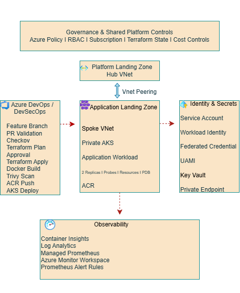

# Azure AKS Application Landing Zone

A governed Azure application landing zone built on top of a shared platform foundation, using private AKS, Terraform, Azure DevOps, Workload Identity, Key Vault, Azure Policy, Checkov, Trivy, Azure Monitor, Log Analytics, and Managed Prometheus.

The solution demonstrates secure infrastructure provisioning, PR-based DevSecOps delivery, controlled Terraform deployment, secretless workload authentication, container security scanning, Kubernetes workload hardening, observability, and operational validation.

## Architecture

The architecture is structured around a governed application landing zone connected to a shared platform foundation through hub-and-spoke networking.

Key architectural areas include:

- Governance and shared platform controls using Azure Policy, RBAC, subscription separation, Terraform remote state, and cost controls.
- Platform Landing Zone with a shared Hub VNet.
- Application Landing Zone with a Spoke VNet, private AKS cluster, application workload, and Azure Container Registry.
- Azure DevOps-based DevSecOps workflow for infrastructure and workload delivery.
- Workload Identity and managed identity-based access to Azure Key Vault.
- Azure-native observability using Container Insights, Log Analytics, Managed Prometheus, Azure Monitor Workspace, and Prometheus alert rules.

## Engineering Objective

The objective of this project was to design and implement a secure, governed, and operationally ready Azure application landing zone for containerized workloads.

The implementation focuses on:

- Infrastructure as Code using Terraform and Azure Verified Modules.
- Separation between platform and application landing zones.
- Private AKS deployment within a spoke network.
- Controlled CI/CD with pull request validation and deployment approvals.
- Security scanning before infrastructure and container deployment.
- Passwordless workload authentication using Azure Workload Identity.
- Policy-driven governance and least-privilege RBAC.
- Kubernetes reliability controls including probes, resource limits, multiple replicas, and Pod Disruption Budget.
- Centralized logs, metrics, Prometheus monitoring, and alerting.
- Operational verification, drift detection, and controlled teardown for cost management.

## Key Capabilities

- Governed application landing zone aligned with Azure landing zone principles.
- Hub-and-spoke network integration between the shared platform foundation and application spoke.
- Private AKS cluster for secure Kubernetes workload hosting.
- Azure Container Registry for container image storage and deployment.
- Terraform-based Infrastructure as Code using Azure Verified Modules.
- Azure DevOps PR-based delivery workflow with separate validation, plan, approval, and apply stages.
- Checkov policy scanning as a blocking Infrastructure as Code security gate.
- Trivy container vulnerability scanning before image promotion.
- Azure Workload Identity with federated credentials and User Assigned Managed Identity for secretless authentication.
- Azure Key Vault integration through private networking and least-privilege RBAC.
- Kubernetes workload hardening using multiple replicas, readiness/liveness probes, resource requests and limits, and Pod Disruption Budget.
- Centralized observability using Container Insights, Log Analytics, Azure Monitor Workspace, and Managed Prometheus.
- Prometheus-based alert rules for workload restart and CPU conditions.
- Operational validation using rollout checks, runtime verification, Terraform drift checks, and controlled teardown for cost management.

## DevSecOps Workflow

Infrastructure and workload changes follow a controlled pull request and deployment workflow:

1. Feature branch created for infrastructure or application changes.
2. Pull request validation runs Terraform formatting, validation, Checkov scanning, and Terraform plan.
3. Required branch policy validates the PR before merge.
4. Changes are reviewed and merged into `main`.
5. Terraform apply runs through a controlled Azure DevOps environment approval.
6. Container image is built and scanned with Trivy.
7. Approved images are pushed to Azure Container Registry using an immutable build ID tag.
8. Kubernetes manifests are applied to AKS and the image is updated to the exact pipeline build.
9. Rollout status and pod health are verified after deployment.

The pipeline uses separate OIDC-based service connections for Terraform plan and apply operations to maintain least-privilege access.

## Security & Governance

- Azure Policy enforces governance requirements across the application landing zone.
- RBAC is applied using least-privilege access for infrastructure deployment and workload access.
- Azure DevOps authenticates to Azure using OIDC-based service connections instead of stored credentials.
- AKS workloads use Azure Workload Identity with a federated credential and User Assigned Managed Identity.
- Key Vault access is limited to the required secrets role and accessed through private networking.
- Checkov provides Infrastructure as Code security and compliance validation before deployment.
- Trivy blocks container promotion when high-severity vulnerabilities are detected.
- Governance controls are validated through policy enforcement, pipeline gates, and runtime verification.

## Reliability & Kubernetes Workload Design

- Application workloads run with multiple replicas to reduce single-pod dependency.
- Readiness and liveness probes support controlled traffic routing and automatic recovery.
- CPU and memory requests and limits provide predictable scheduling and resource control.
- A Pod Disruption Budget helps maintain workload availability during voluntary disruptions.
- ClusterIP services keep application exposure internal to the cluster where appropriate.
- Deployment rollout status and live pod state are verified after each deployment.
- Terraform plan and drift checks are used to validate infrastructure consistency before and after changes.

## Observability & Operations

- Container Insights provides Kubernetes workload and cluster visibility.
- Log Analytics centralizes container and platform logs for operational investigation.
- Azure Monitor Workspace provides the managed metrics platform for AKS.
- Managed Prometheus collects Kubernetes and workload metrics.
- Prometheus alert rules detect container restarts and sustained high CPU conditions.
- Monitoring data was validated using live `KubePodInventory` and `ContainerLogV2` queries.
- Operational checks include rollout verification, pod health validation, alert configuration review, and Terraform drift checks.

## Infrastructure as Code

- Terraform is used to provision and manage the application landing zone.
- Azure Verified Modules are used where appropriate to align with Microsoft-supported patterns.
- Remote state is stored in a dedicated management subscription using Azure Storage with Azure AD authentication.
- Infrastructure changes are validated through formatting, validation, Checkov scanning, and Terraform plan before deployment.
- Separate plan and apply service connections support least-privilege deployment permissions.
- Saved Terraform plans are used for controlled deployment, with fresh plans generated whenever state changes invalidate a previous plan.
- Final drift validation confirmed the deployed environment matched the Terraform configuration before teardown.

## Evidence & Validation

The implementation was validated through deployment outputs, runtime checks, security gates, and operational evidence captured during the project.

Evidence includes:

- Successful Terraform plan and controlled apply pipeline runs.
- Checkov security gate passing with documented exceptions and compensating controls.
- Trivy container scan passing after remediation of high-severity vulnerabilities.
- Successful PR validation and merge workflow.
- AKS workload health with running replicas and successful rollout verification.
- Verified CPU/memory requests and limits and an active Pod Disruption Budget.
- Successful Azure Workload Identity token exchange and Key Vault access from the workload.
- Container Insights and Log Analytics telemetry from the AKS cluster.
- Managed Prometheus and Azure Monitor Workspace configuration.
- Prometheus alert rules for container restarts and high CPU conditions.
- Final Terraform drift check showing no infrastructure changes before teardown.

Supporting screenshots and validation outputs are available in the `evidence/` directory.

## Design Decisions & Trade-offs

- Hub-and-spoke networking was used to separate shared platform connectivity from application workloads and support scalable landing zone design.
- AKS was deployed as a private cluster to reduce public control-plane exposure.
- Azure Workload Identity was selected instead of application secrets to support short-lived, federated authentication.
- Key Vault public access was disabled and private connectivity was used for secret retrieval.
- Azure DevOps OIDC service connections were used instead of stored service principal credentials.
- Separate Terraform plan and apply identities were used to reduce deployment privileges.
- Checkov and Trivy were implemented as blocking security gates, with documented exceptions where controls were intentionally not enabled.
- Azure Container Registry Basic SKU was retained for this lab to balance cost and learning value; Premium-only private registry features were not enabled.
- Azure-native observability was preferred over adding Grafana or other tools because Container Insights, Log Analytics, Managed Prometheus, and Azure Monitor met the project objectives.
- GitOps tooling such as Flux or Argo CD was intentionally excluded to keep the delivery model focused on Azure DevOps pipeline-driven deployment.
- The environment was destroyed after validation to control ongoing Azure cost while preserving Infrastructure as Code, pipeline history, and evidence for reproducibility.

## Key Engineering Learnings

- A successful pipeline does not automatically prove the desired runtime state; Kubernetes resources must be verified directly after deployment.
- Terraform saved plans become stale when infrastructure state changes, so a fresh plan must be generated before retrying deployment.
- Azure resource provider registration can block otherwise valid infrastructure deployments and should be checked during troubleshooting.
- Security tooling is most valuable when used as a blocking gate with documented exceptions and clear remediation paths.
- Container vulnerability findings may come from runtime tooling or vendored dependencies, not only application packages.
- Azure Policy can actively enforce design requirements and should be treated as part of the deployment architecture, not as a post-deployment check.
- Observability should be validated with real workload telemetry, not just by confirming that monitoring resources exist.
- Controlled teardown is part of operational discipline and cost management for non-production environments.

## Project Outcome

The project delivered a secure and governed Azure AKS application landing zone with Infrastructure as Code, controlled DevSecOps delivery, secretless workload authentication, Kubernetes workload hardening, and Azure-native observability.

The environment was validated through infrastructure, security, runtime, identity, monitoring, and drift checks, then safely destroyed to control ongoing cloud costs while preserving the code, pipeline history, architecture, and evidence for future reuse.

## Future Enhancements

Potential future improvements include:

- Azure Container Registry Premium with private endpoint integration.
- Azure Managed Grafana for richer Prometheus visualization.
- Action Groups for production alert notification workflows.
- Additional workload namespaces, network policies, and ingress controls.
- Multi-region or zone-aware architecture for higher availability.
- GitOps-based deployment using Flux or Argo CD where operational scale justifies it.
- Expanded policy, compliance, and FinOps controls for enterprise production use.